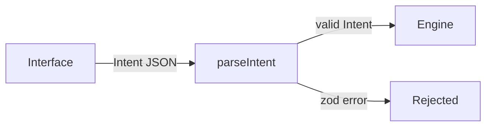

# Inti


Inti is a natural-language investment agent built on NEAR Intents.

> TL;DR: say what you want to do with your money in plain words. Inti turns it into a structured intent that an interface-independent engine can check.

---

## Table of Contents

- [How It Works](#how-it-works)
- [Quick Start](#quick-start)
- [Project Structure](#project-structure)
- [Tech Stack](#tech-stack)
- [License](#license)

## How It Works

The engine accepts only structured `Intent` objects, never raw text. Any interface can build one.



Today the engine validates two intent kinds, `swap` and `transfer`. Amounts are decimal strings, never floats.

### Agent policy

The NEAR Intents [Agent API](https://docs.agentsonintents.com/integration/agent-api/policies-and-limits) runs an agent under a policy its owner signs. Inti builds that policy and checks it before anyone signs:

1. `buildPolicy(draft)` turns a draft in human units ("25 USDC per transaction") into the exact `Policy` type of `@near-intents-agent-api/sdk`. It only emits destinations in `only` mode and never enables `native` methods, so funds can only leave to addresses the owner listed.
2. `describePolicy(policy, tokens)` writes the plain-language preview the owner reads before signing.
3. `assertPolicyMatches(built, preview.policy)` compares the policy the API returns for signing with the one Inti built, and throws on any difference.

### Agent cycle

The LLM decides; the code enforces the limits. Each cycle the model gets the owner goal and four tools: `get_portfolio`, `get_quote`, `swap` and `ask_user`. There is no hard-coded "when to buy" rule. Before any swap runs, `checkSwap` checks it against the signed policy (allowed actions and assets, per-transaction and daily limits, daily USD budget, actions per hour) and returns the Agent API error code on a denial, so the model can adapt.

- `src/agent/loop.ts`: provider-neutral loop. A brain is any object with a `step()` method.
- `src/brains/nearai.ts`: default brain on [NEAR AI Cloud](https://docs.near.ai/cloud/quickstart), model `deepseek-ai/DeepSeek-V4.1-Flash-1017`, which runs inside NEAR AI's TEE (private inference). Each step keeps its response id, which NEAR AI signs inside the TEE.
- `src/brains/anthropic.ts`: fallback brain on Claude Haiku 5.5 through the Anthropic SDK, used only when `NEAR_AI_API_KEY` is not set.
- `propose` mode records swaps for the owner to confirm; `execute` mode runs them inside the policy.
- Today the portfolio is simulated (`SimulatedPortfolio`): live prices from `GET /v1/tokens`, mid-price fills, no fees. No funds move.

Run one cycle (needs `NEAR_AI_API_KEY`, or `ANTHROPIC_API_KEY` as a fallback, in `.env`):

```bash
pnpm cycle "I want some NEAR exposure without much risk"
pnpm cycle --propose "Put half of my USDC into NEAR"
```

### Web login (test page)

`web/` is a minimal page that proves an email or Google login can own an agent. The user signs in with [Privy](https://docs.privy.io), which creates an embedded NEAR wallet (an implicit account). `PrivyNearSigner` plugs that wallet into the near-api-js `Signer`, so near-api-js builds and hashes NEP-413 messages and NEP-366 delegate actions, the two signatures the Agent API asks an owner for, and Privy signs the hash. The page verifies both signatures locally. Nothing is sent to NEAR or the Agent API.

```bash
pnpm web:dev   # needs PRIVY_APP_ID in .env, then open http://localhost:5173
```

## Quick Start

Prerequisites: Node 24 and pnpm 11.

```bash
git clone https://github.com/JaDi03/inti.git
cd inti
pnpm install
pnpm test
```

Expected: 26 tests pass. `src/policy/policy.test.ts` checks that `buildPolicy` reproduces the official quickstart policy byte for byte, using real tokens from `GET /v1/tokens`.

To check the intent schema yourself:

```ts
import { parseIntent } from "./src/index.js";

parseIntent({
  kind: "swap",
  from: { symbol: "USDC", chain: "base" },
  to: { symbol: "NEAR", chain: "near" },
  amount: "10",
}); // returns the Intent
// amount: "-1" throws a zod error
```

Configuration lives in `.env` (copy `.env.example`). No variable is read by the code yet.

## Project Structure

```
src/
  engine/intent.ts       Intent schema and parseIntent
  engine/intent.test.ts  schema tests
  index.ts               public exports
```

## Tech Stack

- **[NEAR Intents](https://docs.near-intents.org)**: cross-chain swaps and transfers (not wired in yet)
- **[@near-intents-agent-api/sdk](https://docs.agentsonintents.com/integration/agent-api/sdk)**: official Agent API types
- **[Anthropic SDK](https://github.com/anthropics/anthropic-sdk-typescript)**: Claude Haiku 5.5 as the provisional brain
- **[Privy](https://docs.privy.io)**: email and Google login with an embedded NEAR wallet
- **[near-api-js](https://github.com/near/near-api-js)**: NEP-413 and NEP-366 encoding
- **[zod](https://zod.dev)**: intent schema validation
- **[vitest](https://vitest.dev)**: tests
- **[TypeScript](https://www.typescriptlang.org)**: language

## License

MIT, see [LICENSE](LICENSE).
