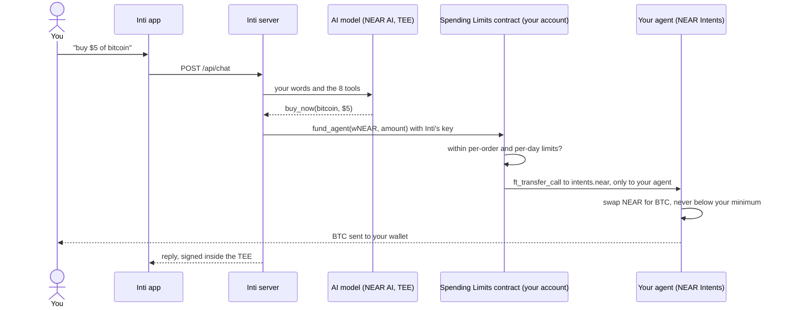
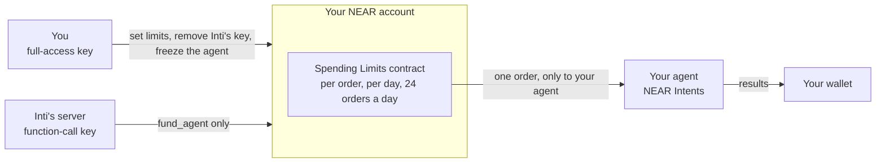

# Inti


Inti is an investment agent on NEAR. You say in plain words what to buy or sell, and it does it from your own wallet, within limits you sign.

Live app: **https://getinti.xyz** (NEAR mainnet, real funds).

Giving an AI agent money usually means giving it your keys. With Inti your funds stay in your wallet. Inti gets a key that can only send orders, and a contract on your own account refuses any order above your limits.

---

## Table of Contents

1. [Why Inti exists](#why-inti-exists)
2. [Try it](#try-it)
3. [What an intent is, and why it matters here](#what-an-intent-is-and-why-it-matters-here)
4. [How it works](#how-it-works)
5. [Your limits and Inti's key](#your-limits-and-intis-key)
6. [Check it yourself](#check-it-yourself)
7. [Run your own server](#run-your-own-server)
8. [Project structure](#project-structure)
9. [Tech stack](#tech-stack)
10. [Built during the NEAR hackathon](#built-during-the-near-hackathon)

## Why Inti exists

Every year there are fewer barriers to using a blockchain. The ones left are the ones that stop careful people:

- **Signing what you cannot read.** A wallet asks you to approve a string of code.
- **A mistake you cannot undo.** One wrong network or address and the money is gone.
- **Handing an AI the keys to your money.** An agent that can trade for you can usually also empty your account.

Inti removes those three. You sign in with email or Google, you type "buy $5 of bitcoin", and you read in plain words what you are about to sign. The agent never writes an address, and the limits you set are enforced by a contract on your own account, not by Inti's server.

## Try it

Open **https://getinti.xyz** on a phone or a computer.

**Without funds** (nothing moves):

1. Sign in with email or Google. You see your dashboard and an empty NEAR wallet that [Privy](https://docs.privy.io) made for you. You never see a seed phrase.
2. Next to the logo, a shield says **AI hardware verified**. Tap it to see each check on the AI model's hardware and run them again.
3. In the chat, type `buy $5 of bitcoin`. Inti answers in plain words. Under the reply you see **Simulated portfolio, no real funds moved**: until you have an agent and a signed permission, every order runs on a practice portfolio.
4. Under the same reply, tap **Signed by the verified AI model** to see the signature over that exact answer.

**With real funds** (NEAR mainnet):

5. Open **Spending limits** and follow its four steps in order:
   - **Protect your account** with a passkey.
   - **Add funds**: send NEAR to the address shown. The step tells you how much is needed (about 1.9 NEAR with 0.1 NEAR set aside for orders; it grows with what you set aside). About 1.7 NEAR of it pays for the contract's storage on your account and comes back when you **Turn off Inti**.
   - **Create your agent**: your own agent on NEAR Intents, which can send only to you.
   - **Set your spending limits** and tap **Activate Inti**. You sign two transactions. The first installs the Spending Limits contract on your account, sets your limits and gives Inti a key that can only call `fund_agent`. The second wraps the NEAR you set aside for orders.
6. Sign a trading permission (a grant) for your agent, for 7, 30 or 90 days.
7. Type `buy $5 of gold`, `buy Zcash if it drops to $900`, or `sell half my bitcoin and buy euro with it`. The agent places each order, one after another, and tells you what it got and what it cost. The result appears in your portfolio. To ask the price without buying, type `how much bitcoin do I get for $5?`.
   A real use on mainnet, 14 November 2026: `buy $5 of gold`, then `sell it, half for bitcoin and half for euro`. On chain you see only two transactions:
   - [`C68paMYv`](https://nearblocks.io/txns/C68paMYvQmm9AWrfvErLXuEMNrcFQEsy4wmBRugaWhJh): the Spending Limits contract on the user's account sends 1.488 wNEAR to the user's agent in NEAR Intents, after checking the limits.
   - [`5cr7nwxz`](https://nearblocks.io/txns/5cr7nwxzMiqmBeEHgN73v3vWs52E5HJ6Ad83SZAYhTLB): NEAR Intents sends 0.00003638 BTC to the user's wallet.

   The gold purchase, its sale and the euro happened inside the agent's confidential balance, so no public transaction shows them. The euro stays with the agent (see [Where your assets sit](#where-your-assets-sit)).
8. Type an order above your limit. Inti tells you it is over your limit, and no transaction is sent, so you pay no fee. Your limits are checked twice: first by Inti, which reads them from your contract before it signs anything (`agent/server/orders.ts`, `fund`), and then by the contract itself on chain. The second check holds even if Inti's server were wrong or compromised; its refusals are covered by the contract's tests (`contracts/spending-limits/tests/`).
9. To stop Inti at once, tap **Pause Inti** (deletes Inti's key from your account) or freeze your agent (it can do nothing until you unfreeze it). Both are your signature, not Inti's.

## What an intent is, and why it matters here

An intent is a signed statement of what you want ("I want $5 of bitcoin, and I accept no less than this much"), not the steps to get it. Solvers compete to fill it, and the network checks that the result matches what you signed.

That idea came with a promise: people would say what they want and the chain would stay out of sight. NEAR's co-founder Illia Polosukhin [wrote in 2023](https://www.coindesk.com/opinion/2023/12/20/the-rise-of-chain-abstraction-and-end-of-blockchain-factionalism): "hopefully, users won't have to manage or even know about the technical layers."

Inti takes that promise literally. The words you type become an intent on [NEAR Intents](https://docs.near-intents.org), placed by your own agent through the [Agent API](https://docs.agentsonintents.com). What stays visible is what should: your limits, what each order spends, and where your money is at every step.

## How it works



1. **You write** what you want. The app sends it to Inti's server, which checks your Privy sign-in on every request.
2. **The model decides.** It runs on [NEAR AI Cloud](https://docs.near.ai/cloud/quickstart) inside a TEE (private hardware) and picks one of eight tools. It names an asset and an amount in dollars; it never writes an address.
3. **The contract checks.** Inti's key calls `fund_agent` on your account. The contract adds the order to what the last 24 hours already spent and refuses it if a limit would be passed.
4. **Your agent trades.** The NEAR goes to your own agent on NEAR Intents, which swaps it with a minimum you accept, from its confidential balance.
5. **The result comes home.** Bitcoin, ether and Zcash go to your wallet. Anything left with the agent is sent back to your wallet every 5 minutes.

### The agent

The model decides; the code and the contract enforce the limits.

- `agent/core/loop.ts`: the loop. A brain is any object with a `step()` method.
- `agent/brains/nearai.ts`: the brain, model `deepseek-ai/DeepSeek-V4.1-Flash-1017` on NEAR AI Cloud, which runs inside NEAR AI's TEE.
- `agent/server/realTools.ts`: the eight tools the model can call: `get_portfolio`, `get_quote`, `buy_now`, `buy_at_price`, `get_sell_quote`, `sell_now`, `send_near_to_wallet` and `ask_user`.

```ts
export const ASSETS = {
  bitcoin: { name: "Bitcoin", symbol: "BTC", assetId: "nep141:nbtc.bridge.near", decimals: 8, kind: "crypto" },
```

`agent/policy/assets.ts`: the model chooses from a fixed list by name. The token address comes from this file, so a prompt hidden in a message cannot make the agent pay somewhere else.

### Where your assets sit

The agent buys and sells bitcoin (BTC), ether (ETH) and Zcash (ZEC), and pays with NEAR. These go to your wallet.

It also buys gold (XAUT), euro (EURe) and Solana (SOL) (`agent/policy/heldAssets.ts`). These stay in your agent's confidential balance on NEAR Intents, and the dashboard shows how much your agent holds of each, with its price. When you ask Inti to sell, the agent sells for NEAR and sends the NEAR to your wallet.

Why they stay with the agent: since 12 November 2026 the Agent API trades only from the agent's confidential balance. From there it can send to a NEAR wallet only tokens that live on NEAR, and these three live on Ethereum, Gnosis and Solana.

What this means for you:

- The agent's rules are the ones you signed: it can send only to you, and you can freeze it at any time with your own signature.
- Withdrawals and sales go through the agent, so they need Inti's server to be running. While it is down, your gold, euro and SOL stay with your agent. They do not move anywhere else.

Until 12 November 2026 Inti sent gold, euro and Solana to the user's NEAR wallet. That version is in the tag [`gold-euro-sol-final`](https://github.com/JaDi03/inti/tree/gold-euro-sol-final). One of its trades on mainnet, a sale of gold for Solana on 12 November 2026:

1. [`7BrWbDgR`](https://nearblocks.io/txns/7BrWbDgRiVyknCV2Trr5KrggQvMMRNH1K9XQVvavhnhx): the Spending Limits contract on the user's account sends 0.000062 XAUT to the agent in NEAR Intents.
2. [`CCAuxeuM`](https://nearblocks.io/txns/CCAuxeuMU2BsLT5ZeMWEcS9jnFrXpvk9R9g46TeAvVRs): the agent gives the gold to a market maker.
3. [`2S16iWuB`](https://nearblocks.io/txns/2S16iWuBepvzSeoykpxMBV3z5CmfoV8cRvCfPbPRvjZw): the market maker gives 0.002874 SOL to the agent.
4. [`9N1LZEDu`](https://nearblocks.io/txns/9N1LZEDuh4STZYtx6QLbVtkmnXoGcb8H1U7uupWCbdDV): the SOL leaves NEAR Intents for the user's wallet.

### Server and web app

`agent/server/` is the API the web app calls: `POST /api/chat` runs the agent for the signed-in user, and the `/api/agent/*` routes create the user's agent and the grant the user signs. It checks the Privy access token on every request with Privy's public verification key, so it never needs the Privy app secret.

`web/` is the app. `PrivyNearSigner` plugs the Privy wallet into the near-api-js `Signer`, so near-api-js builds and hashes NEP-413 messages and NEP-366 delegate actions, the two signatures the Agent API asks an owner for, and Privy signs the hash.

## Your limits and Inti's key



You keep your full-access key, in your Privy wallet. Inti gets a NEAR function-call key that is scoped to one contract (your own account) and one method (`fund_agent`), with no deposit allowed.

What Inti's key **can** do: send one order to your own agent, within your limits.

What Inti's key **cannot** do, because the network or the contract refuses it:

- send NEAR or tokens to anyone, including itself;
- call any method other than `fund_agent`, or attach a deposit;
- change your limits or your agent (`set_limit`, `remove_limit` and `set_agent` require 1 yoctoNEAR, which a function-call key cannot attach);
- choose where an order goes: `fund_agent` takes no destination, it always pays your agent;
- add or remove keys, or deploy code.

```rust
require!(new_spent <= limit.per_day.0, "over the daily limit");
```

```ts
if (amount > limit.perOrder) return "over_order_limit";
if ((await chain.spentLast24h(account.owner, token)) + amount > limit.perDay) return "over_daily_limit";
```

`agent/server/orders.ts`: before it signs an order, Inti reads your limits and what the last 24 hours spent from your own contract. An order over a limit is stopped here, so it never reaches the chain and costs you nothing.

`contracts/spending-limits/src/lib.rs`: the contract checks again. Before Inti's key sends an order, the contract adds it to what the last 24 hours already sent. If the total would pass your daily limit, the order is refused and nothing moves. Even with Inti's key, nobody can spend more than your limits.

Inti's key also has a gas allowance of 0.25 NEAR (`web/src/limits/config.ts`), from which it pays each order's network fee. It is one total, not per day, and the dashboard shows what is left under **Fees left for Inti**. When it runs out, Inti cannot send orders; **Pause Inti** and then **Resume Inti** add the key again with a new allowance.

If Inti's key were stolen, the most it could do is send your limits to your own agent, use up the 24 orders of a day, and spend its 0.25 NEAR allowance on fees. Deleting the key ends all three. Because your account keeps its full-access key, it never depends on that allowance and cannot be locked out by it.

The Agent API adds a second layer: your agent runs under a policy you sign, which only lets it send to your wallet.

Contract details, tests and formal proofs: [Spending Limits contract](contracts/spending-limits/README.md).

## Check it yourself

### The contract on mainnet is this code

The contract is verified on [SourceScan](https://nearblocks.io/address/91e0e128471dd3633637fd82850489b14c84cf9d41f45e83f33e74e8e52880be) (verification transaction [`9spE94qW`](https://nearblocks.io/txns/9spE94qWajKdyTLbbZM5y1fWa2wGinkFj8AkeFVyrvby)). To rebuild it and compare the hash yourself, you need Linux, macOS or WSL, Docker running, and [cargo-near](https://github.com/near/cargo-near) (tested with 0.23.0; the build itself runs inside the pinned Docker image). The build writes its git commit into the wasm, so check out the commit that was deployed, `cb3fe63`, the one the contract's on-chain metadata names. It takes about 2 minutes.

```bash
git clone https://github.com/JaDi03/inti.git
cd inti
git checkout cb3fe63
cd contracts/spending-limits
cargo near build reproducible-wasm
sha256sum target/near/inti_spending_limits.wasm
# ec08c308af218f6d1273a1ae785617d67b9bb3fa3ed95f843a5e1a9c19c3d161
```

The same hash is in `web/src/limits/config.ts`, and it matches `web/public/inti-spending-limits.wasm`, the only build the app installs.

### The AI model's hardware, checked live

```ts
if (reportData.slice(64) === nonce) passed.add("binds_nonce");
if (reportData.slice(0, 64) === signingAddress.slice(2).padEnd(64, "0")) passed.add("binds_key");
```

`agent/server/attestation.ts`: Inti sends NEAR AI a new random challenge and gets back the hardware report of its model. It checks the Intel TDX quote against Intel's own certificates ([@phala/dcap-qvl](https://github.com/Phala-Network/dcap-qvl)), that the quote carries the challenge and the model's signing key, that the machine is not in debug mode, that its startup log and published setup match what the chip measured, and asks NVIDIA whether the GPU is genuine. The steps follow [NEAR AI's verification docs](https://docs.near.ai/cloud/verification). One recent result is shared by everyone who opens the app; "Verify again" runs a new one.

### Each reply, signed

```ts
if (sig.text !== `${model}:${call.requestHash}:${call.responseHash}`) return "other_bytes";
```

`agent/server/replyProof.ts`: every AI model call behind a reply keeps the SHA-256 of the exact bytes sent and received (`agent/brains/nearai.ts`). NEAR AI signs those hashes inside the chip; Inti checks that the signature covers them, names the model, and comes from the key the hardware check found.

Together they prove that a genuine, sealed Intel TDX machine with an NVIDIA GPU, running this model, signed each reply. They do not prove which of the model's machines served it (they share one key), which software runs inside beyond its own measurements, or that your messages are hidden: NEAR AI's gateway and Inti's server both see them.

## Run your own server

The app and its API on your own server, at `https://your-domain.com`. You need Ubuntu or Debian (x64, tested on Ubuntu 24.04), a user with `sudo`, and a domain pointing to the server with ports 80 and 443 open.

```bash
git clone https://github.com/JaDi03/inti.git
cd inti
cp .env.example .env && chmod 600 .env
nano .env                       # INTI_SITE and the four keys at the top of the file
sudo bash deploy/install.sh
```

| Key | Where it comes from |
|---|---|
| `NEAR_INTENTS_AGENT_API_KEY` | your partner key for the [Agent API](https://docs.agentsonintents.com) |
| `NEAR_AI_API_KEY` | [cloud.near.ai](https://cloud.near.ai) |
| `PRIVY_APP_ID`, `PRIVY_VERIFICATION_KEY` | your app in the [Privy dashboard](https://dashboard.privy.io) |

`.env.example` points the Agent API at `https://api.demo.agentsonintents.com`. NEAR Intents and the Agent API have no testnet, so orders through that host are real orders on NEAR mainnet.

The script checks `.env` before it installs anything and says what is missing. It installs Node, pnpm and Caddy, creates Inti's key and the key that encrypts the grants, builds the app, and starts the API behind HTTPS. It ends with `Done. Open https://your-domain.com`. In the Privy dashboard, add that domain to the app's allowed domains.

To update, or to apply a changed setting, run the same command from the same folder:

```bash
cd inti
sudo bash deploy/install.sh
```

The script first updates the folder with `git pull`, then installs exactly that commit. It runs as root, so whoever can push to the branch you cloned decides what runs on your server: clone a repository you trust, or your own fork.

`.env` is merged into `/etc/inti/inti.env` and removed, so no copy with your keys stays in the folder you cloned. To change a setting, edit that file, or write a new `.env` with only the settings to change, and run the command again. The key that encrypts the grants is made once and never replaced.

Each install is a new release. If the new one does not start, the previous one keeps running.

| What | Where |
|---|---|
| The live release (code, packages and built app), owned by root; the previous one is kept | `/opt/inti/current`, `/opt/inti/releases` |
| Where the system user `inti-build` builds the app; it cannot read any key | `/var/lib/inti-build` |
| Settings, readable only by root and `inti` | `/etc/inti/inti.env` |
| Inti's key and the users' grants, readable only by `inti` | `/var/lib/inti` |
| The API, run by the system user `inti`, which cannot change the code, and restarted if it stops | systemd: `inti-agent` (`journalctl -u inti-agent -f`) |
| The app with HTTPS, and `/api` to the API | Caddy: `/etc/caddy/inti.caddy` |

Users authorize Inti's key on their own account. Keep a copy of `/var/lib/inti/inti-key.json` and of `SERVER_GRANT_KEY` from `/etc/inti/inti.env`. To move to a new server without asking users to do it again, copy `inti-key.json` and `grants.json` to the new server's `/var/lib/inti/`, and put `SERVER_GRANT_KEY` in its `.env`, before you run the script. It keeps a key and grants that are already there.

To run it on your computer or change the code, see [CONTRIBUTING.md](CONTRIBUTING.md).

## Project structure

```
agent/                 the investment agent (TypeScript)
  core/                loop, simulated portfolio, money math
  brains/              model adapters: NEAR AI Cloud, scripted brain for tests
  policy/              the assets the agent trades, token units
  server/              the API the web app calls, orders and grants
  cli/new-key.ts       create Inti's key for a local setup
contracts/
  spending-limits/     NEAR contract on the user's own account (Rust)
web/                   app: login, Spending Limits, chat (React)
deploy/                install.sh and the server files it sets up
```

## Tech stack

- **[NEAR Intents](https://docs.near-intents.org)**: the swaps and price orders behind every buy and sell
- **[NEAR Intents Agent API](https://docs.agentsonintents.com)**: each user's own agent, its signed policy and its confidential balance; types from [@near-intents-agent-api/sdk](https://docs.agentsonintents.com/integration/agent-api/sdk)
- **[NEAR AI Cloud](https://docs.near.ai/cloud/quickstart)**: private inference in a TEE, through the [OpenAI SDK](https://github.com/openai/openai-node)
- **NEAR function-call access keys**: Inti's key, limited to `fund_agent` on the user's account
- **[near-sdk-rs](https://github.com/near/near-sdk-rs)** and **[cargo-near](https://github.com/near/cargo-near)**: the Spending Limits contract and its reproducible build
- **[Privy](https://docs.privy.io)**: email and Google login with an embedded NEAR wallet
- **[near-api-js](https://github.com/near/near-api-js)**: NEAR transactions, NEP-413 and NEP-366 encoding
- **[fastify](https://fastify.dev)**: the API server
- **[zod](https://zod.dev)**: checks settings, requests and the model's tool calls
- **[vitest](https://vitest.dev)**: tests
- **[TypeScript](https://www.typescriptlang.org)**: language

## Built during the NEAR hackathon

Inti was written from scratch for the NEAR hackathon (build window 1 to 14 November 2026). The first commit is from 5 November 2026, and every change since is in the [commit history](https://github.com/JaDi03/inti/commits/main). No code from an earlier product is reused, and no other project of ours is entered in this hackathon. Open-source libraries are the ones listed under [Tech stack](#tech-stack).

Tracks it is built for: **AI Security & Defense** (spending limits, a function-call key, TEE attestation), **Unstoppable DeFi** (trading through NEAR Intents with no custodian) and **Privacy & Private AI** (the model runs in a TEE, the agent trades from a confidential balance).

## License

MIT, see [LICENSE](LICENSE).
