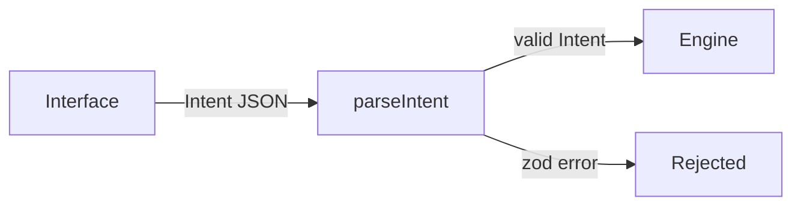

# Inti


Inti is a natural-language investment agent built on NEAR Intents.

> TL;DR: say what you want to do with your money in plain words. Inti turns it into a structured intent that an interface-independent engine can check.

---

## Table of Contents

- [How It Works](#how-it-works)
- [Quick Start](#quick-start)
- [Self-host](#self-host)
- [Project Structure](#project-structure)
- [Tech Stack](#tech-stack)
- [License](#license)

## How It Works

The engine accepts only structured `Intent` objects, never raw text. Any interface can build one.



Today the engine validates two intent kinds, `swap` and `transfer`. Amounts are decimal strings, never floats.

### Agent policy

The NEAR Intents [Agent API](https://docs.agentsonintents.com/integration/agent-api/policies-and-limits) runs an agent under a policy its owner signs. Inti builds that policy and checks it before anyone signs:

1. `buildPolicy(draft)` turns a draft in human units ("25 USDC per transaction") into the exact `Policy` type of `@near-intents-agent-api/sdk`. It only emits destinations in `only` mode and never enables `native` methods, so funds can only leave to addresses the owner listed.
2. `describePolicy(policy, tokens)` writes the plain-language preview the owner reads before signing.
3. `assertPolicyMatches(built, preview.policy)` compares the policy the API returns for signing with the one Inti built, and throws on any difference.

## Quick Start

Prerequisites: Node 24 and pnpm 11, and the accounts listed under [What you need](#what-you-need).

```bash
git clone https://github.com/JaDi03/inti.git
cd inti
pnpm install
cp .env.example .env               # fill in your own keys
node scripts/new-keys.mjs ../inti-key.json   # set SERVER_INTI_KEY_FILE=../inti-key.json, plus the two lines it prints
pnpm server                        # agent API on http://localhost:8787
pnpm web:dev                       # app on http://localhost:5173
```

This is the real app on NEAR mainnet: what you buy or sell with it moves real funds.

## Self-host

You can run your own Inti on your own domain, with your own accounts. Nothing in the repo points to anyone else's server or keys: every address and credential comes from your `.env`.

### What you need

- A server with Ubuntu 24.04 that you reach with `ssh` as root (or a user with `sudo`).
- A domain with two DNS `A` records pointing to the server, for example `your-domain.com` (the app) and `api.your-domain.com` (the agent API). Ports 80 and 443 open: Caddy gets the HTTPS certificates by itself.
- A [NEAR AI Cloud](https://cloud.near.ai) API key (`NEAR_AI_API_KEY`).
- A NEAR Intents [Agent API](https://docs.agentsonintents.com) partner key (`NEAR_INTENTS_AGENT_API_KEY`).
- A [Privy](https://dashboard.privy.io) app: its App ID and its verification key (App settings > Basics > Verify with key instead). Add your app domain to the app's allowed origins.

### 1. Prepare the server (once)

From your clone:

```bash
ssh root@your-server 'bash -s -- https://github.com/you/inti.git' < scripts/setup-server.sh
```

`scripts/setup-server.sh` installs Node (official build, checksum checked), pnpm and Caddy, creates a user `inti` with no login shell, and clones the repo to `/home/inti/app`. The agent runs as that user and may write only to `/home/inti/data`.

### 2. Create Inti's keys (once)

On your computer, after `pnpm install`:

```bash
node scripts/new-keys.mjs ../inti-key.json
```

It writes Inti's key to `../inti-key.json`, outside the clone so it can never be committed, and prints `INTI_KEY_PUBLIC` and `SERVER_GRANT_KEY` for your `.env`. Clear the terminal after copying them. Each user adds that public key to their own NEAR account with permission to call only `fund_agent`. Keep the file safe: a new key means every user has to sign again.

### 3. Write the production `.env` and copy it up

Start from `.env.example` and save it as `.env.production`. The lines under "Production server" there say which values change on a server. Then copy both secrets up; each lands readable only by the user `inti`:

```bash
ssh root@your-server 'install -m 600 -o inti -g inti /dev/stdin /home/inti/app/.env' < .env.production
ssh root@your-server 'install -m 600 -o inti -g inti /dev/stdin /home/inti/data/inti-key.json' < ../inti-key.json
```

### 4. Deploy

```bash
bash scripts/deploy.sh root@your-server
```

The server pulls `main`, installs, builds the web app, publishes it, writes its Caddyfile from your `.env` (`scripts/caddyfile.mjs`, with the headers in `web/security-headers.json`), installs the service (`deploy/inti-agent.service`, sent from your clone) and restarts the agent when its code changed. Root on the server never runs a file the user `inti` can change: the build and the Caddyfile run as `inti`, and root only checks and installs the result. Then the script checks your app and API from your computer. Run the same command after every merge to `main`.

## Project Structure

```
agent/                 the investment agent (TypeScript)
  core/                loop, tools, limit checks, portfolio
  brains/              model adapters: NEAR AI Cloud, scripted brain for tests
  policy/              Agent API policy: build, preview, verify
  engine/              Intent schema and parseIntent
  cli/cycle.ts         run one agent cycle from the terminal
  index.ts             public exports
contracts/
  spending-limits/     NEAR contract on the user's own account (Rust)
web/                   app: login, Spending Limits, chat (React)
deploy/                systemd service for the agent API
scripts/               server setup, deploy, Caddyfile and key generation
```

## Tech Stack

- **[NEAR Intents](https://docs.near-intents.org)**: cross-chain swaps and transfers (not wired in yet)
- **[@near-intents-agent-api/sdk](https://docs.agentsonintents.com/integration/agent-api/sdk)**: official Agent API types
- **[NEAR AI Cloud](https://docs.near.ai/cloud/quickstart)**: private inference in a TEE, through the [OpenAI SDK](https://github.com/openai/openai-node)- **[Privy](https://docs.privy.io)**: email and Google login with an embedded NEAR wallet
- **[near-api-js](https://github.com/near/near-api-js)**: NEP-413 and NEP-366 encoding
- **[zod](https://zod.dev)**: intent schema validation
- **[vitest](https://vitest.dev)**: tests
- **[TypeScript](https://www.typescriptlang.org)**: language

## License

MIT, see [LICENSE](LICENSE).
