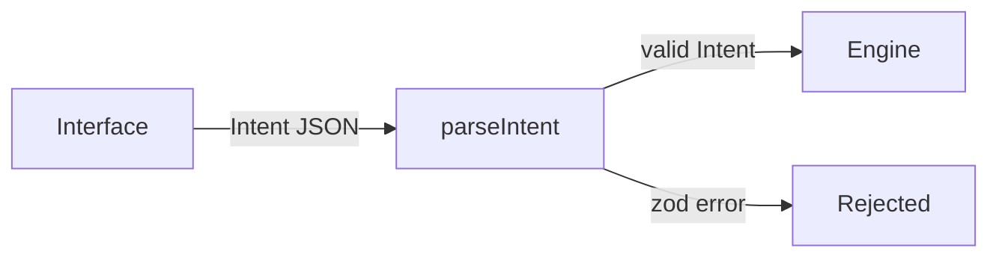

# Inti


Inti is a natural-language investment agent built on NEAR Intents.

> TL;DR: say what you want to do with your money in plain words. Inti turns it into a structured intent that an interface-independent engine can check.

---

## Table of Contents

- [How It Works](#how-it-works)
- [Quick Start](#quick-start)
- [Project Structure](#project-structure)
- [Tech Stack](#tech-stack)
- [License](#license)

## How It Works

The engine accepts only structured `Intent` objects, never raw text. Any interface can build one.



Today the engine validates two intent kinds, `swap` and `transfer`. Amounts are decimal strings, never floats.

### Agent policy

The NEAR Intents [Agent API](https://docs.agentsonintents.com/integration/agent-api/policies-and-limits) runs an agent under a policy its owner signs. Inti builds that policy and checks it before anyone signs:

1. `buildPolicy(draft)` turns a draft in human units ("25 USDC per transaction") into the exact `Policy` type of `@near-intents-agent-api/sdk`. It only emits destinations in `only` mode and never enables `native` methods, so funds can only leave to addresses the owner listed.
2. `describePolicy(policy, tokens)` writes the plain-language preview the owner reads before signing.
3. `assertPolicyMatches(built, preview.policy)` compares the policy the API returns for signing with the one Inti built, and throws on any difference.

## Quick Start

Prerequisites: Node 24 and pnpm 11.

```bash
git clone https://github.com/JaDi03/inti.git
cd inti
pnpm install
pnpm test
```

Expected: 16 tests pass. `src/policy/policy.test.ts` checks that `buildPolicy` reproduces the official quickstart policy byte for byte, using real tokens from `GET /v1/tokens`.

To check the intent schema yourself:

```ts
import { parseIntent } from "./src/index.js";

parseIntent({
  kind: "swap",
  from: { symbol: "USDC", chain: "base" },
  to: { symbol: "NEAR", chain: "near" },
  amount: "10",
}); // returns the Intent
// amount: "-1" throws a zod error
```

Configuration lives in `.env` (copy `.env.example`). No variable is read by the code yet.

## Project Structure

```
src/
  engine/intent.ts       Intent schema and parseIntent
  engine/intent.test.ts  schema tests
  index.ts               public exports
```

## Tech Stack

- **[NEAR Intents](https://docs.near-intents.org)**: cross-chain swaps and transfers (not wired in yet)
- **[@near-intents-agent-api/sdk](https://docs.agentsonintents.com/integration/agent-api/sdk)**: official Agent API types
- **[zod](https://zod.dev)**: intent schema validation
- **[vitest](https://vitest.dev)**: tests
- **[TypeScript](https://www.typescriptlang.org)**: language

## License

MIT, see [LICENSE](LICENSE).
