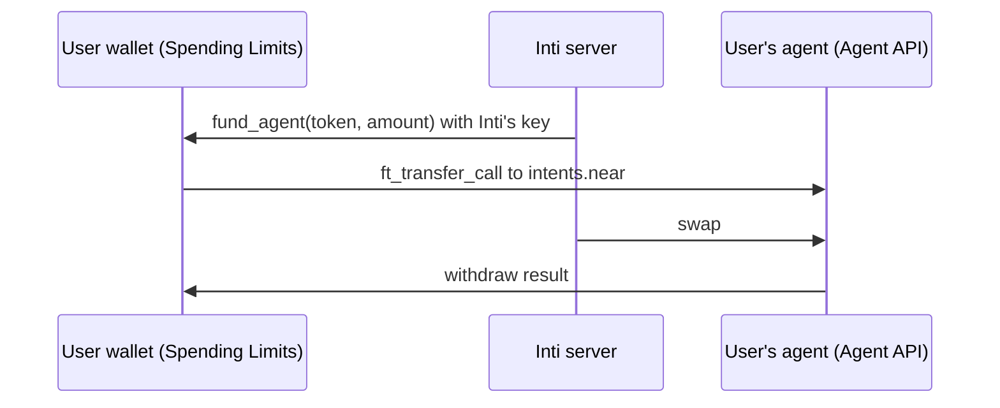

# Inti

An AI agent that buys, sells and swaps assets on NEAR Intents from a chat, inside spending limits enforced on the user's own NEAR account.

Live: [getinti.xyz](https://getinti.xyz) (NEAR mainnet, real funds).

## How it works

1. **Sign in.** Email or Google through [Privy](https://docs.privy.io), which creates an embedded NEAR wallet. `web/src/privySigner.ts` adapts it to a near-api-js `Signer`. Every signature requires a passkey or authenticator app on the account (`web/src/limits/ownerSigner.ts`).
2. **Create the agent.** The user's agent is created on the NEAR Intents [Agent API](https://docs.agentsonintents.com) under a policy the user signs, and the user signs a trading grant (7, 30 or 90 days) that lets the server place orders for it (`web/src/agent/`, `agent/server/agents.ts`, `agent/server/grants.ts`).
3. **Activate.** One transaction on the user's account deploys the Spending Limits contract (only the build whose sha256 is pinned in `web/src/limits/config.ts`), sets per-order and per-day limits per token, and adds Inti's function-call key, which can call only `fund_agent`. A second one wraps the NEAR the user sets aside for orders (`web/src/limits/client.ts`).
4. **Chat.** `POST /api/chat` runs the model on [NEAR AI Cloud](https://docs.near.ai/cloud/quickstart) (`deepseek-ai/DeepSeek-V4.1-Flash-1017`, in a TEE) with these tools: `get_portfolio`, `get_quote`, `get_sell_quote`, `buy_now`, `sell_now`, `buy_at_price`, `ask_user` (`agent/server/realTools.ts`). The model picks an asset by key from `agent/policy/assets.ts`; it never writes a token id or an address.
5. **Execute.** For an order, Inti's key calls `fund_agent`, which moves the amount from the wallet to the agent; the agent swaps through the Agent API and the result is withdrawn back to the wallet (`agent/server/orders.ts`). Limit orders rest on the agent until they fill or expire, and a sweep returns leftovers every 5 minutes.



## Limits

Two independent checks stand between the model and the funds:

- **On chain** (`contracts/spending-limits/`): per order, per rolling 24 hours, at most 24 orders a day, per token. Inti's key cannot change limits (that needs a full-access key and 1 yoctoNEAR). Removing the key stops Inti at once. Details and proofs in [contracts/spending-limits/README.md](contracts/spending-limits/README.md).
- **On the server** (`agent/server/trading.ts`): one daily limit in US dollars across buying, selling and swapping, checked before any order starts.

## Run locally

Node 24, pnpm 11. You need your own NEAR AI Cloud key, Agent API partner key and Privy app (App ID and verification key, with `http://localhost:5173` in its allowed origins).

```bash
pnpm install
node scripts/init-env.mjs --data ../inti-data   # creates .env and Inti's key; fill in the block it lists
pnpm server                                      # API on :8787
pnpm web:dev                                     # app on :5173
```

## Deploy

Ubuntu 24.04 server with root over ssh, ports 80 and 443 open, and DNS for the app and API hosts.

```bash
bash scripts/deploy.sh root@HOST --init               # once: installs, clones, creates .env and Inti's key
ssh -t root@HOST sudo -u inti nano /home/inti/app/.env  # fill in the "Fill in" block
bash scripts/deploy.sh root@HOST                      # deploy, and again for every release
```

`--branch <name>` deploys another branch (default `main`); `--repo <url>` another repo (default your `origin`). Inti's key and `SERVER_GRANT_KEY` are created on the server once and never replaced, because users sign for that key.

The agent runs as `inti` under `deploy/inti-agent.service` and can write only to `/home/inti/data`. Root on the server never executes a file `inti` can modify: the build and the Caddyfile render (`scripts/caddyfile.mjs`) run as `inti`, and the unit file is sent from your checkout.

## Tests

```bash
pnpm typecheck && pnpm lint && pnpm test && pnpm build && pnpm web:build
```

CI runs the same on every pull request. Contract tests, sandbox tests and Kani proofs: [contracts/spending-limits/README.md](contracts/spending-limits/README.md).

## Layout

```
agent/core/        agent loop, tool runner, money math
agent/brains/      NEAR AI Cloud adapter
agent/policy/      Agent API policy build and checks, tradable assets
agent/server/      HTTP API, orders, grants, dashboard
contracts/         Spending Limits contract (Rust)
web/               React app
scripts/, deploy/  server setup, deploy, key generation, systemd unit
```

## License

MIT, see [LICENSE](LICENSE).
