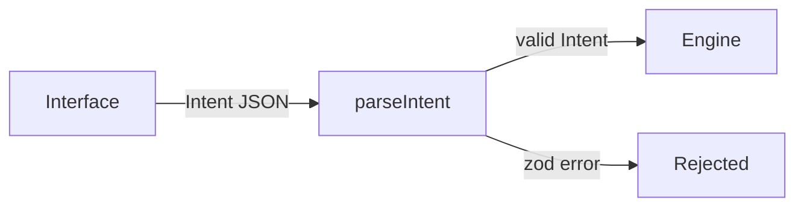

# Inti


Inti is a natural-language investment agent built on NEAR Intents.

> TL;DR: say what you want to do with your money in plain words. Inti turns it into a structured intent that an interface-independent engine can check.

---

## Table of Contents

- [How It Works](#how-it-works)
- [Quick Start](#quick-start)
- [Project Structure](#project-structure)
- [Tech Stack](#tech-stack)
- [License](#license)

## How It Works

The engine accepts only structured `Intent` objects, never raw text. Any interface can build one.



Today the engine validates two intent kinds, `swap` and `transfer`. Amounts are decimal strings, never floats.

### Agent policy

The NEAR Intents [Agent API](https://docs.agentsonintents.com/integration/agent-api/policies-and-limits) runs an agent under a policy its owner signs. Inti builds that policy and checks it before anyone signs:

1. `buildPolicy(draft)` turns a draft in human units ("25 USDC per transaction") into the exact `Policy` type of `@near-intents-agent-api/sdk`. It only emits destinations in `only` mode and never enables `native` methods, so funds can only leave to addresses the owner listed.
2. `describePolicy(policy, tokens)` writes the plain-language preview the owner reads before signing.
3. `assertPolicyMatches(built, preview.policy)` compares the policy the API returns for signing with the one Inti built, and throws on any difference.

### Agent cycle

The LLM decides; the code enforces the limits. Each cycle the model gets the owner goal and four tools: `get_portfolio`, `get_quote`, `swap` and `ask_user`. There is no hard-coded "when to buy" rule. Before any swap runs, `checkSwap` checks it against the signed policy (allowed actions and assets, per-transaction and daily limits, daily USD budget, actions per hour) and returns the Agent API error code on a denial, so the model can adapt.

- `agent/core/loop.ts`: provider-neutral loop. A brain is any object with a `step()` method.
- `agent/brains/nearai.ts`: the brain, on [NEAR AI Cloud](https://docs.near.ai/cloud/quickstart), model `deepseek-ai/DeepSeek-V4.1-Flash-1017`, which runs inside NEAR AI's TEE (private inference). Each step keeps its response id, which NEAR AI signs inside the TEE.
- `propose` mode records swaps for the owner to confirm; `execute` mode runs them inside the policy.

`pnpm cycle` runs one cycle from the terminal on a simulated portfolio (`SimulatedPortfolio`): live prices from `GET /v1/tokens`, mid-price fills, no fees. No funds move. It needs only `NEAR_AI_API_KEY` in `.env`:

```bash
pnpm cycle "I want some NEAR exposure without much risk"
pnpm cycle --propose "Put half of my USDC into NEAR"
```

### Agent server

`agent/server/` exposes the agent to the web app: `POST /api/chat` runs one cycle for the signed-in user, and the `/api/agent/*` routes create the user's agent on the Agent API and the trading grant the user signs. The server checks the Privy access token on every request with Privy's public verification key, so it never needs the Privy app secret. Orders are real: they spend the user's funds within the limits the user signed.

### Web app

`web/` is the app. The user signs in with email or Google through [Privy](https://docs.privy.io), which creates an embedded NEAR wallet (an implicit account). `PrivyNearSigner` plugs that wallet into the near-api-js `Signer`, so near-api-js builds and hashes NEP-413 messages and NEP-366 delegate actions, the two signatures the Agent API asks an owner for, and Privy signs the hash.

## Quick Start

Prerequisites: Node 24 and pnpm 11.

```bash
git clone https://github.com/JaDi03/inti.git
cd inti
pnpm install
pnpm test
```

To run the app, copy `.env.example` to `.env` and fill in your own values:

| Value | Where it comes from |
|---|---|
| `NEAR_INTENTS_AGENT_API_KEY` | your partner key for the [Agent API](https://docs.agentsonintents.com) |
| `NEAR_AI_API_KEY` | [cloud.near.ai](https://cloud.near.ai) |
| `PRIVY_APP_ID`, `PRIVY_VERIFICATION_KEY` | your app in the [Privy dashboard](https://dashboard.privy.io) |
| `SERVER_GRANT_KEY` | the command in `.env.example` |
| `SERVER_INTI_KEY_FILE`, `INTI_KEY_PUBLIC` | `pnpm new-key` creates the key file and prints both |

Then start the server and the web app:

```bash
pnpm new-key
pnpm server    # agent API on http://localhost:8787
pnpm web:dev   # app on http://localhost:5173
```

For a public deployment, set `INTI_API_URL` to your API's URL and `SERVER_ALLOWED_ORIGINS` to your site's origin, build the app with `pnpm web:build` and serve `web/dist` with the headers in `web/security-headers.json` (`{INTI_API_ORIGIN}` is the origin of `INTI_API_URL`).

To check the intent schema yourself:

```ts
import { parseIntent } from "./agent/index.js";

parseIntent({
  kind: "swap",
  from: { symbol: "USDC", chain: "base" },
  to: { symbol: "NEAR", chain: "near" },
  amount: "10",
}); // returns the Intent
// amount: "-1" throws a zod error
```

## Project Structure

```
agent/                 the investment agent (TypeScript)
  core/                loop, tools, limit checks, portfolio
  brains/              model adapters: NEAR AI Cloud, scripted brain for tests
  policy/              Agent API policy: build, preview, verify
  engine/              Intent schema and parseIntent
  cli/cycle.ts         run one agent cycle from the terminal
  index.ts             public exports
contracts/
  spending-limits/     NEAR contract on the user's own account (Rust)
web/                   app: login, Spending Limits, chat (React)
```

## Tech Stack

- **[NEAR Intents](https://docs.near-intents.org)**: cross-chain swaps and transfers (not wired in yet)
- **[@near-intents-agent-api/sdk](https://docs.agentsonintents.com/integration/agent-api/sdk)**: official Agent API types
- **[NEAR AI Cloud](https://docs.near.ai/cloud/quickstart)**: private inference in a TEE, through the [OpenAI SDK](https://github.com/openai/openai-node)
- **[Privy](https://docs.privy.io)**: email and Google login with an embedded NEAR wallet
- **[near-api-js](https://github.com/near/near-api-js)**: NEP-413 and NEP-366 encoding
- **[zod](https://zod.dev)**: intent schema validation
- **[vitest](https://vitest.dev)**: tests
- **[TypeScript](https://www.typescriptlang.org)**: language

## License

MIT, see [LICENSE](LICENSE).
